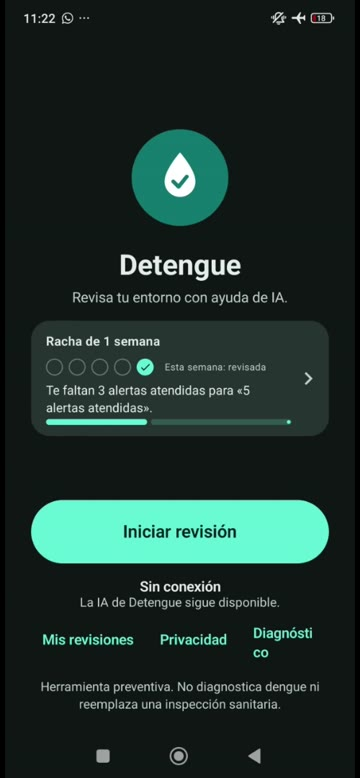
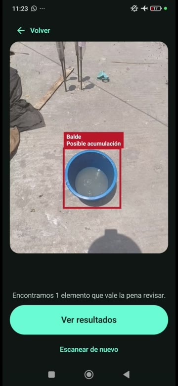
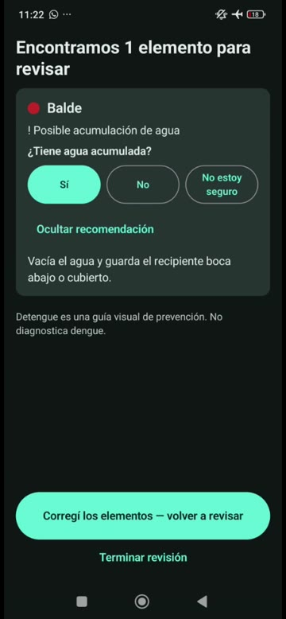
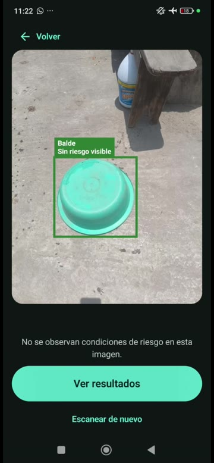
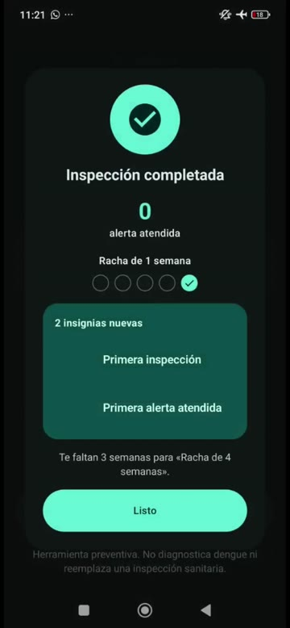
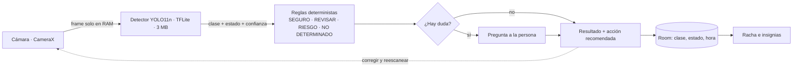
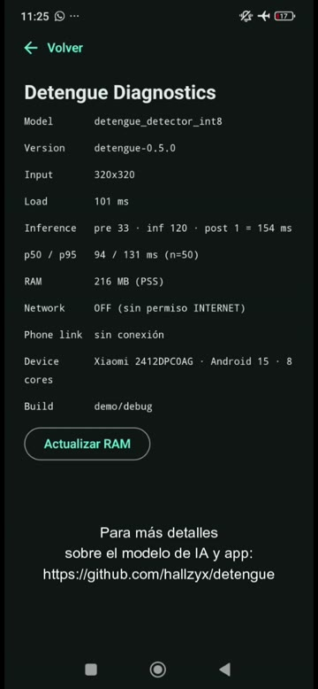
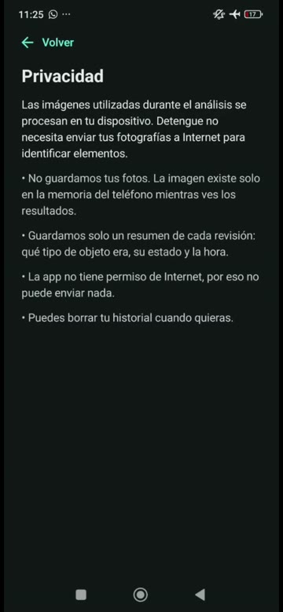

# Detengue

> *10 minutos contra el dengue, asistidos por IA.*

App Android que ayuda a **revisar tu casa en busca de recipientes que acumulan agua** (criaderos del *Aedes aegypti*).
La visión artificial corre **en el teléfono**: sin Internet, en celulares económicos y sin enviar tus fotos a ningún servidor.
Detengue **no diagnostica dengue** ni reemplaza una inspección sanitaria.

|  |  |
|---|---|
| 🎬 **Video** (problema + solución + demo, 3 min) | [Ver en Google Drive](https://drive.google.com/file/d/1HBrZApuOl1I-TQ9OFBMpiGAix2FLl0yT/view?usp=sharing) |
| 📱 **Probar la app** | APK de debug en cada [ejecución de *Android CI*](https://github.com/hallzyx/detengue/actions/workflows/android.yml) (artefacto `detengue-debug-apk`) |
| 🧠 **Modelo** | [`docs/MODEL_CARD.md`](docs/MODEL_CARD.md) |
| 🔒 **Privacidad** | [`docs/PRIVACY.md`](docs/PRIVACY.md) |

<p align="center">
  
  
  
  
  
</p>
<p align="center"><sub>Capturas del demo, grabado con el teléfono en <b>modo avión</b>. De izquierda a derecha: inicio sin conexión · riesgo detectado · pregunta humana · sin riesgo tras corregir · racha e insignias.</sub></p>

## El problema

En 2026, hasta la semana epidemiológica 33, Perú acumulaba **46 669 casos de dengue y 57 fallecidos**, un **+53 %** frente a los
30 587 del mismo periodo de 2025 (CDC-Minsa; datos provisionales, reportados por prensa: confirmar en el sitio del CDC antes de citar).
No hay tratamiento específico: la prevención es eliminar los criaderos, y están en baldes, tinas y tanques de cada casa.
Pero revisar bien exige saber **qué** mirar y **cómo** comprobar que ya se corrigió. Además, el 95,7 % de los hogares peruanos tiene celular
(88,1 % en zonas rurales; INEI, IV trim. 2025), pero no siempre tiene datos ni un teléfono potente.

## La solución

1. Apuntas la cámara y pulsas **Analizar** (o **Barrer zona**, un barrido de 5 s que junta los hallazgos en una galería).
2. Un detector en el teléfono reconoce el recipiente **y su estado** (abierto, con agua, volteado, tanque) y propone una acción.
3. Si hay duda, **te pregunta a ti** ("¿tiene agua acumulada?"): la decisión final es humana.
4. Corriges (vacías, volteas, tapas), **vuelves a escanear** y ves el antes/después.
5. Sumas **racha semanal e insignias** que premian *atender* alertas, no encontrar riesgo.

### Gamificación

Es local y simple: se calcula del historial que ya existe (sin red, sin fotos, sin tablas nuevas).

| Elemento | Regla |
|---|---|
| Alerta atendida | pendientes iniciales (según la IA) − pendientes finales (tras reescaneo y respuestas) |
| Racha | semanas seguidas (lunes a domingo) con al menos una inspección completada; sigue viva hasta el domingo |
| Insignias | Primera inspección · Primera alerta atendida · 5 alertas atendidas · Racha de 4 semanas |
| Siguiente meta | la insignia bloqueada a la que le falta menos |

Limitación conocida (documentada en el código): responder "No" a una alerta también la cuenta como atendida. Sirve para un demo,
**no como métrica de impacto**. La motivación es la de una app de hábitos: la idea de producto es que, a futuro, las rachas se conecten
con incentivos de aliados (por ejemplo, descuentos), algo que **no está implementado**.

## Cómo funciona



- **Un solo detector** con clases *objeto+estado* (`bucket:water`, `bucket:inverted`…): una inferencia, menos RAM y latencia
  (ver [`docs/DECISIONS.md`](docs/DECISIONS.md)).
- **Reglas fuera del modelo**: umbrales centralizados (detección 0,40 · incierto 0,50 · riesgo/seguro 0,70). El modelo propone, las reglas
  y la persona deciden.
- **Sin fotos guardadas**: el frame vive en memoria durante el análisis. El historial guarda solo clase, estado, confianza, acción y hora.

## Principios

- **Offline-first**: el manifiesto **no declara `INTERNET`**; la app no puede abrir conexiones. CI lo verifica
  (`scripts/check-permissions.sh`, `scripts/check-no-network-code.sh`).
- **Privacy-first**: nada de fotos en disco, sin analítica, `allowBackup=false`.
- **Low-end-first**: `minSdk 26`, análisis bajo demanda, modelo de 3 MB, sin inferencia continua a 30 FPS.
- **Human-in-the-loop**: todo resultado ambiguo termina en una pregunta o en *Revisar manualmente*.

## Qué tan bien funciona (medido)

Modelo `detengue-0.5.0`: YOLO11n ajustado, 320×320, pesos int8 + activaciones float32, **3,0 MB**. Detalle completo en la
[model card](docs/MODEL_CARD.md).

| Medición | Resultado |
|---|---|
| Test real, PyTorch FP32 (93 fotos) | precisión 0,917 · recall 0,853 · mAP@0,5 **0,907** |
| Latencia en teléfono (pantalla de diagnóstico) | inferencia ≈ 120 ms; p50 **94 ms** / p95 **131 ms** (n = 50); RAM ≈ 216 MB |
| Dispositivo de esa medición | Xiaomi 2412DPCOAG, Android 15, 8 núcleos: **un teléfono reciente, no de gama baja** |
| Red durante la medición | `OFF (sin permiso INTERNET)` |

<p align="center">
  
  
</p>

Lo que **no** está resuelto, dicho sin rodeos:

- **Falsas alarmas.** Simulando la app sobre 47 fotos reales, 4 de 7 objetos que no son balde (cestos, ollas) y 2 baldes secos salen como
  RIESGO. Se priorizó no pasar por alto agua, y la confirmación humana es la red de seguridad.
- **Agua poco profunda:** 3 de 11 fotos con agua no dan alerta de riesgo.
- **Datos pequeños:** pocos baldes distintos y test de 3 a 16 instancias por clase de balde. Las métricas por clase no son evidencia sólida.
- **Latencia en gama baja sin medir:** solo hay medición en un teléfono reciente. El benchmark para otros equipos está en `ml/benchmark/`.

## Compilar y probar

Requisitos: JDK 17+ y Android SDK (compileSdk 35).

```bash
cd android
./gradlew assembleDebug        # APK en app/build/outputs/apk/debug/
./gradlew testDebugUnitTest    # tests unitarios
```

El workflow [`Android CI`](.github/workflows/android.yml) compila, ejecuta tests y lint, aplica las guardas anti-red y publica el APK.
Para reproducir el demo, ver [`docs/DEMO.md`](docs/DEMO.md). Para reentrenar el modelo, ver [`ml/README.md`](ml/README.md) y [`ml/WSL.md`](ml/WSL.md).

## Estructura

```
android/   App Android (Kotlin, Jetpack Compose, CameraX, Room, TFLite)
ml/        Datos, entrenamiento, evaluación, export y simulación de la app (Python)
docs/      Model card, decisiones, privacidad, guion de demo, PRD (fuente original de requisitos)
video/     Fuente del intro animado (HTML + Playwright + ffmpeg) y sus renders
scripts/   Guardas de CI (sin permiso de red, sin código de red)
```

## Estado

| Fase | Contenido | Estado |
|------|-----------|--------|
| 1 | Onboarding, home, permiso de cámara, CameraX, captura de frame | ✅ |
| 2 | Inferencia local (TFLite), cajas alineadas | ✅ |
| 3 | Reglas, resultados, recomendaciones, reescaneo, antes/después | ✅ |
| 4 | Room, historial, privacidad, diagnóstico, guardas anti-red en CI | ✅ |
| 5 | Pipeline ML, model card, modelo MVP entrenado | ✅ |
| 6 | Barrido de zona (5 s) y galería de hallazgos | ✅ |
| 7 | Gamificación: racha, insignias, siguiente meta y celebración | ✅ |

## Cómo se construyó

Detengue se desarrolló **con Claude (Anthropic) como asistente de programación**, en una sesión de trabajo conjunta: la app Android
(Kotlin/Compose), las guardas de CI, el pipeline de ML, la model card y demás documentación, y el intro animado del video salieron de ese
trabajo, con los commits co-firmados por Claude. La gamificación (racha, insignias, galería del barrido) la desarrolló un subagente
de Claude (Opus 5.5) lanzado desde esa misma sesión, en ramas propias que luego se integraron. La dirección del producto, las decisiones, el entrenamiento en su propio equipo
(GPU RTX 3050 en WSL2), las pruebas en el teléfono y la grabación del demo son de **@hallzyx**.

Esto afecta a cómo leer el repo: el código y el modelo no los ha auditado un tercero, y las cajas del dataset las revisó un asistente de IA,
no un experto sanitario. Por eso las limitaciones están escritas con tanto detalle.

## Datos, créditos y licencias

- **Fotos propias** de baldes y tinas, **imágenes sintéticas** generadas con IA (solo en entrenamiento) y copias degradadas de estas.
- **Imágenes web** de Openverse (CC0 / PDM / BY / BY-SA); la lista de atribuciones la genera `ml/collect_openverse.py` y está en [`docs/ATTRIBUTION.md`](docs/ATTRIBUTION.md).
- **Silva** (Roboflow Universe, **GPL-3.0**): solo la clase `water_tank`.
- Etiquetado asistido con **Grounding DINO**; las cajas las revisó un asistente de IA, no un experto sanitario.
- Entrenamiento y export con **Ultralytics YOLO11** (AGPL-3.0). Inferencia con **TensorFlow Lite**.
- **Licencia del código y del modelo: por definir.** Falta decidir cómo tratar la GPL-3.0 del dataset de Silva y la AGPL-3.0 de Ultralytics
  antes de elegir una licencia; ver "Limitaciones" en la model card.

Es un **prototipo (MVP)** hecho para un concurso: probado a mano en un teléfono, sin validación con inspectores de salud.
